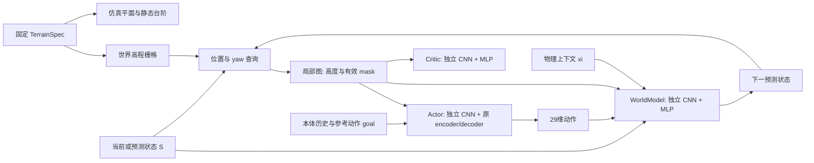

# 高程图首版：入口与验证边界

> 当前 checkout 是独立 `Ae` 实验分支。新增方案、运行命令和对照条件请先看 [Ae.md](Ae.md)；以下保留基础高程图版本的背景说明。

这是 **G1 的感知 motion tracking 原型**。它延续 SuperMimic 的参考动作条件与可微动力学训练，还不是速度指令 locomotion 项目。

## 代码隔离

- 当前目录：`Code/SuperMimicHeightmap`，独立 Git 仓库，分支 `Heightmap`。
- `main` 保留上游提交 `a1508d42c9d1699a52e8233ab16d08c488441ab9`；用 `git diff main` 查看本次新增内容。
- 相邻 `Code/SuperMimicVibed` 保持原样。新的容器/镜像名为 `supermimic-heightmap`，不会指向原容器。
- 后端沿用复现固定版本的 Isaac Lab 3 + Newton + MuJoCo Warp。**此步没有迁移 mjlab。**

## 数据流



局部图覆盖 **前后 1.1 m、左右 0.7 m，间隔 5 cm，15×23 点**；这是参考 N3 工程选定的首版规格，不是声称 PIM 官方采用相同网格。图像列沿本体 heading 的 x 增大，行沿 y 增大；只旋转 yaw，不随 roll/pitch 倾斜。两通道分别为 `terrain_z − base_z`（米）与有效 mask，越界/未知格为 `(0,0)`。

三个网络各自使用 `Conv 2→8→16`、flatten、`MLP 384→64→32` 编码地图。当前没有额外加入 attention、SwAV、MoE、RSSM 或教师学生蒸馏。

| 阶段 | 地图与动作来自哪里 | 更新什么 |
|---|---|---|
| 仿真采样 | 当前真实位姿查询地图；actor 产生动作并加探索噪声 | 保存状态、动作、上下文与下一状态，更新输入/输出统计 |
| 世界模型 | 从真实起点开始，用 replay 的动作连续预测；每一步按**预测位姿**重新查询地图 | 多步状态误差 loss 更新 WM 与它自己的 CNN |
| Actor | 当前策略在预测状态上持续产生新动作；每一步重新查询地图 | 最大化想象回报及末端 value，经 BPTT 更新 actor 与它自己的 CNN |
| Critic | 想象轨迹已 detach；按每个轨迹状态查询地图 | TD-lambda target 的 MSE 更新 critic 与它自己的 CNN |

Actor 更新期间冻结 WM/critic **参数**，保留它们对状态、动作及地图的输入梯度。三个编码器不共享权重，因此 actor 不会偷偷改变冻结动力学模型的地图表示。

世界模型输出仍是原实现的状态增量；reward、observation、termination 仍由原解析函数计算。没有另加预测深度图的网络。

## 地形与 checkpoint

默认 `--terrain flat`。`--terrain steps` 是显式实验选项，创建三个高度为 4/8/4 cm 的固定方块；不是完整 terrain curriculum。盒体碰撞和栅格顶面来自同一 `TerrainSpec`。普通非凸 mesh 在当前 MuJoCo 碰撞配置下可能变成凸包，故首版用原生 box。

台阶边缘的双线性采样是连续梯度代理，会把离散边缘平滑到邻近栅格；它不等于真实碰撞导数。世界地图覆盖参考根轨迹并预留 2 m 范围，越界通过 mask 表达。所有环境使用相同地形、零平移原点，训练期间不重建地形，所以 replay 无需逐条保存地图或 terrain ID。后续若每环境/每 episode 改地形，必须先扩展 replay 的地图身份信息。

台阶模式保守过滤靠近障碍的初始参考帧。**不抬高 reset root，不自动修改 reference motion。** 原奖励含绝对参考根位置，参考动作能否在台阶上完成仍需实验验证；无安全帧时会明确报错。

Checkpoint 保存 `heightmap` 元数据与指纹。旧上游 checkpoint 不能直接接着训练这个新网络；需要另做显式权重转换。本分支恢复完整训练使用 `last.pt`，`ckpt_*.pt` 是轻量评估快照。恢复会重新预填 replay，保留迭代数和优化器；不保证随机数、采样器和仿真状态逐位复现。失败的恢复校验不会覆盖旧运行元数据；同目录重新训练必须显式 resume 或另选目录。

## 在本机查看和测试

已有项目内 CPU 测试环境 `.venv`，无需安装 Isaac Lab：

```powershell
cd C:\Users\26312\Desktop\IROS2027\Code\SuperMimicHeightmap
$env:OMP_NUM_THREADS = '1'
.\.venv\Scripts\python.exe -m pytest -q --tb=line -p no:cacheprovider
```

测试包括坐标/高度符号、缺失 mask、yaw 梯度、三个网络的参数更新、真实多步 rollout，以及解析坡面上第一步动作经第二步地图查询的梯度。专用梯度测试已经用临时 `detach` 突变验证过：断开位姿梯度会使它失败。

## 后续 GPU 仿真验证命令

以下命令供**配置好上游固定 Linux/CUDA 环境、机器人资产和参考动作数据之后**执行。本次没有安装大型仿真镜像、下载动作数据或启动 GPU 训练。

从本目录运行上游 `tools/setup.sh`、`docker/run_container.sh`、`tools/download_data.sh` 会使用独立的 `supermimic-heightmap` 镜像与容器。不要照抄 README 下半部分保留的旧容器名。

先跑平地小规模完整更新（8 步 replay 拟合、4 步想象）：

```bash
docker exec supermimic-heightmap python supermimic/train.py \
  --terrain flat --num_envs 16 --buffer_steps 64 --warmup_steps 16 \
  --wm_window 8 --wm_batches 1 --wm_batch 16 \
  --pi_batch 16 --horizon 4 --wm_only_iters 2 \
  --critic_epochs 1 --critic_minibatches 2 --value_batch 64 \
  --iterations 6 --ckpt_every 3 --log_every 1 --amp none \
  --log_dir logs/HeightmapSmoke
```

检查 loss/梯度有限、仿真状态有限、正常保存后，再用相同架构与地形参数加 `--resume logs/HeightmapSmoke/last.pt --iterations 8` 验证恢复预填。随后再扩展 batch/horizon。默认不 `torch.compile`；完成 eager smoke 后再显式加 `--compile`，测量性能和显存。

评估与绘图：

```bash
docker exec supermimic-heightmap python supermimic/evaluate.py \
  --run_dir logs/HeightmapSmoke --ckpt logs/HeightmapSmoke/last.pt
docker exec supermimic-heightmap python supermimic/evaluate.py --run_dir logs/HeightmapSmoke
docker exec supermimic-heightmap python tools/plot.py logs/HeightmapSmoke --protocol full
```

`--safe_starts` 会从每段动作的首个安全帧开始，评估的是剩余片段，不能与完整起点指标混用。结果分别写入 `Eval_full` 和 `Eval_safe`；`tools/plot.py --protocol safe` 读取后者。`--record` 会保存同源台阶，视频工具也会显示这些台阶。旧 `tools/bench.py` 明确保留为 `map_dim=0` 的盲策略动力学基准，不反映高程图分支速度。

建议随后比较 `--map_dim 0` 与默认 `32`，使用相同地形、motion 子集和随机种子。台阶测试需要额外核验实体高度、接触面和重置过滤；通过 CPU 测试不能替代这些检查。

## 尚未完成的部分

- Isaac Lab / Newton 的实际 GPU smoke、台阶接触与默认 `4096×32` 显存测试。
- 深度图→点云→里程计融合→高程图的部署映射器，以及遮挡/噪声/延迟下的训练。当前 actor 看到的是真值局部图，属于 oracle perception baseline。
- 任意地形的参考动作适配、系统性消融、真实 G1 部署。没有新训练结果或性能提升结论。

地图接口统一仅统一数据格式；真值图和实测地图的可见范围、缺失、误差与延迟仍需单独处理。
