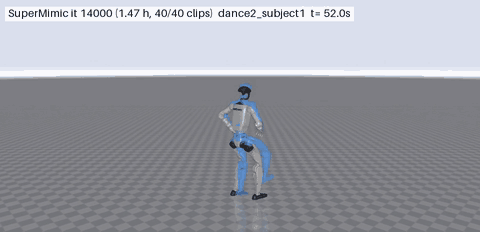
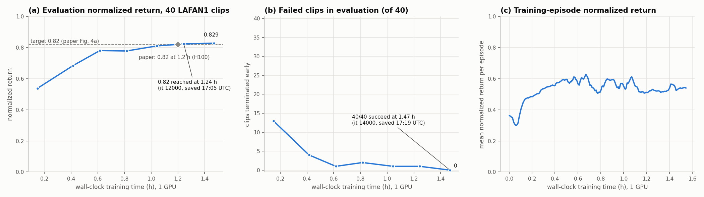

# SuperMimic-perceptive

这是在高程图感知 SuperMimic 原型上，研究**先预训练高程图 AE，再冻结并共享编码器**的独立实验版本。基于 [zita-ch/supermimic_vibed](https://github.com/zita-ch/supermimic_vibed) 的非官方 SuperMimic 复现；保留上游 [MIT License](LICENSE) 和 ETH Zurich / Chong Zhang 署名。

截至 **2026-10-24（中国时间）**，AE 预训练及 GPU 训练、恢复和评估流程验证已完成，四组控制对照实验正在进行。已上传的曲线和 JSON 是历史快照，不能代表阅读时的服务器实时进度，也不能据此宣布 AE 优于基线。

优先阅读 [Ae.md](Ae.md)（方法、数据、对照与限制）、[Progress.md](Progress.md)（运行记录）；[Guide.md](Guide.md) 说明早期高程图原型，涉及当前 AE 版本时以本页和 `Ae.md` 为准。

## 两阶段流程

1. **几何预训练**：局部高程图与有效性通道 `[B,2,15,23]` → CNN 编码器 → 32 维隐向量 → 解码器 → 重建高度与有效性。损失是有效格子上的高度 MSE 加有效性 BCE。
2. **控制训练**：移除控制路径中的 AE 解码器，冻结同一个编码器实例，供 actor、可微世界模型和 critic 使用。下游优化器不更新编码器权重，checkpoint 保存编码器及哈希；冻结权重仍保留通过地图输入向预测位姿传递梯度的能力。

同一想象步内 actor 与世界模型可复用编码结果；预测位姿发生变化时，必须重新查询对应位置的高程图。critic 编码它所评价状态的地图。基线模式保留三套分别训练的地图编码器。

**当前是仿真真值高程图原型**：使用与物理场景一致的静态地形，根据模拟或预测的身体位姿查询局部图。尚未接入真实深度相机、里程计、深度点云融合与在线高程图重建；不是完整的真机感知部署方案，也未验证任意地形泛化。

## 对照与结果快照

| 运行 | 地形 | 地图编码器 |
|---|---|---|
| FlatAe | 平地 | 预训练、冻结、共享 |
| StepsAe | 4/8/4 cm 台阶 | 预训练、冻结、共享 |
| FlatBase | 平地 | 三套独立可训练 CNN |
| StepsBase | 4/8/4 cm 台阶 | 三套独立可训练 CNN |

四组从零开始，采用相同训练配置与 `seed=0`：4096 环境、4096 actor batch、4096 世界模型 batch、`torch.compile`，目标 16000 次迭代。这是单种子、AE 预训练/共享/冻结的组合对比，不能分别归因于三个设计因素。训练速度还受 GPU 和并发负载影响；AE 预训练耗时需单独计入。

- [Curves.png](results/Curves.png)、[Status.json](results/Status.json)：**2026-10-24 19:22 左右（中国时间）**取回的训练与评估快照，训练迭代和评估迭代可能不同步。
- [Reconstruction.png](results/Reconstruction.png)、[Report.json](results/Report.json)：正式 AE 候选的重建检查与验证报告。
- [Validation.json](results/Validation.json)：GPU smoke、恢复与评估流程的验证记录，不是最终控制性能结论。

## 依赖与运行入口

控制训练需要 Linux、NVIDIA GPU，以及固定到 `46d6cc3d7b115906fad12efd372fbf69f4e3d3ed` 的 Isaac Lab 3 kit-less 环境（Newton / MuJoCo-Warp）。本项目不是 mjlab 项目。AE 预训练不启动仿真器，但需要兼容的 PyTorch 及绘图依赖。

`IsaacLab/`、`data/`、Python 环境和训练 checkpoint 不随 Git 上传。依赖与素材来源保留在 `tools/setup.sh`、`tools/download_data.sh` 及下方上游说明中。LAFAN1 动作和机器人资源仍须分别遵守其来源许可。

首次配置独立机器时，可以使用已有 Docker 脚本：

```bash
bash tools/setup.sh
bash docker/run_container.sh 0 128g
bash tools/download_data.sh
docker exec -it supermimic-heightmap bash
```

脚本目前沿用 `supermimic-heightmap` 镜像/容器名，并将当前仓库挂载到 `/workspace/supermimic`；它不会另建名为 SuperMimicAE 的 Docker 容器。如果机器已经运行同名容器，应使用独立容器名并对应调整下载脚本中的 `docker exec` 目标，避免混用目录。

在已经配置好的运行环境中，从仓库根目录执行以下入口（使用新的输出目录）：

```bash
# 1. 预训练；得到 logs/AeFinal/Encoder.pt 和重建报告
python supermimic/Pretrain.py --out logs/AeFinal --steps 60000 --lr .0003

# 2. 冻结共享 AE 的平地控制训练
python supermimic/train.py \
  --num_envs 4096 --pi_batch 4096 --wm_batch 4096 \
  --compile --buffer_steps 512 --warmup_steps 64 --wm_window 8 --wm_batches 5 \
  --horizon 32 --value_batch 4096 --amp bf16 --terrain flat \
  --wm_only_iters 500 --iterations 16000 --ckpt_every 1000 --log_every 50 \
  --seed 0 --log_dir logs/FlatAe --ae logs/AeFinal/Encoder.pt

# 保存第一个 checkpoint 后，在另一进程评估全部动作
python supermimic/evaluate.py --run_dir logs/FlatAe --ckpt logs/FlatAe/ckpt_001000.pt
```

台阶 AE 对照使用 `--terrain steps --log_dir logs/StepsAe`；Base 对照去掉 `--ae`，并分别使用新的 `logs/FlatBase` / `logs/StepsBase`。四组独立进程须分配各自的可用 GPU；新硬件先完成较小规模 eager smoke，再启用全量编译配置。

`Server/` 是当前实验服务器的启动、检查与报告脚本，包含固定工作路径及 GPU 分配。尤其 `Server/Setup.sh` 依赖已经存在的 Heightmap 环境和打包文件，**不能作为一台空白机器的通用安装命令**。这些脚本与本地目录之间没有自动同步机制；快照通过显式复制更新。

## 上游资料的边界

下方保留的成绩、曲线、GIF、训练命令和实现说明属于原始平地复现。**GIF 不是本项目 AE 版本的效果，原版的训练时间和成绩也不是本分支的结果。** 下方旧命令中的 `supermimic` 容器名与本分支脚本不同；本分支训练入口使用上文和 `Ae.md`。

---

## Upstream: SuperMimic reproduction on Isaac Lab 3 (kit-less, MuJoCo-Warp)

**Unofficial** reproduction of *SuperMimic: Scaling Humanoid Whole-Body Control with One Differentiable World
Model* (arXiv 2610.28480) — no official code is released, so everything here is implemented from
the paper. Target experiment: the controlled LAFAN1 comparison (Fig. 4a): 40 G1-retargeted LAFAN1
clips (2.45 h), one GPU; the paper reaches evaluation normalized return 0.82 after 1.2 h on an H100.

Author: **Chong Zhang** (ETH Zurich). License: [MIT](LICENSE).

> **Disclaimer:** this repository was speed-vibecoded in 1 hour with an AI coding
> assistant. It
> deliberately does not live under any lab's organization, because the code is too much "slop"
> for that: fast and unreviewed. Use it at
> your own risk.

> **One G1 motion tracker for all 40 LAFAN1 clips, trained in only ~1.5 GPU-hours**
> (1.47 h on a single RTX PRO 6000): evaluation return **0.829** with **0/40 failed clips**.
> For scale, the paper's PPO-in-simulator baseline does not reach return 0.82 within 18 h on up to
> 8 GPUs.



*Solid robot: the trained policy simulated in Isaac Lab with MuJoCo-Warp. Blue ghost: the reference
motion. Clips: dance, jumps, fall-and-get-up, sprint.*

Progress and timestamps: [MILESTONES.md](MILESTONES.md).

## Layout

| Path | What |
|---|---|
| `IsaacLab/` | Isaac Lab `main` @ 46d6cc3 (VERSION 3.0.0), unmodified — cloned by `tools/setup.sh`, not tracked |
| `docker/` | `Dockerfile`: `supermimic:latest` = `isaac-lab-kitless:main-46d6cc3` (built from `IsaacLab/docker/Dockerfile.kitless`) + tmux, ffmpeg, gcc (for `torch.compile`); `run_container.sh` |
| `data/` | not tracked; `tools/download_data.sh` fetches LAFAN1 G1 retargets (HF `lvhaidong/LAFAN1_Retargeting_Dataset`) and the G1 URDF/meshes, then builds `g1_29dof.xml` (MJCF) and the USD |
| `supermimic/` | implementation (see below) |
| `tools/` | setup, asset conversion, tests, benchmark, plotting, rendering, failure analysis |
| `logs/<run>/` | not tracked: `train_log.csv`, `eval.csv`, checkpoints, stdout |
| `results/` | success curve and highlight GIF (full videos are rendered locally with `tools/render.py`) |

## Setup

Neither Isaac Lab nor any data is included in this repository; the steps below fetch them.

**Requirements:** Linux, an NVIDIA GPU (tested: RTX PRO 6000 Blackwell, driver 580 / CUDA 13),
Docker with the NVIDIA Container Toolkit (`docker run --gpus` must work), ~20 GB of disk for the
images and ~0.2 GB for the data.

Physics: Newton with the MuJoCo-Warp solver (`NewtonCfg(MJWarpSolverCfg(...))`), no Kit, no PhysX;
50 Hz control, 4 substeps of 5 ms, implicitfast integrator, MuJoCo collision pipeline.

### 1. Isaac Lab (kit-less Docker image)

The code runs against Isaac Lab 3 `main` at commit
[`46d6cc3`](https://github.com/isaac-sim/IsaacLab/commit/46d6cc3d7b115906fad12efd372fbf69f4e3d3ed)
(VERSION 3.0.0), unmodified, inside Isaac Lab's **kit-less** image (no Isaac Sim / Kit, no PhysX).
Newer `main` commits may work but are untested.

```bash
tools/setup.sh
```

which is equivalent to:

```bash
git clone https://github.com/isaac-sim/IsaacLab.git
git -C IsaacLab checkout 46d6cc3d7b115906fad12efd372fbf69f4e3d3ed
(cd IsaacLab && docker build -f docker/Dockerfile.kitless -t isaac-lab-kitless:main-46d6cc3 .)
docker build -t supermimic:latest docker/     # + tmux, ffmpeg, gcc, NVIDIA EGL vendor file
```

Then start the long-lived container (repository mounted at `/workspace/supermimic`):

```bash
docker/run_container.sh 0 128g     # GPU index 0, 128 GB memory cap
```

### 2. Data: LAFAN1 motions and the G1 model

| What | Source | License | Goes to |
|---|---|---|---|
| 40 LAFAN1 clips retargeted to the 29-DoF G1 (30 fps CSV: root pos, root quat xyzw, 29 joint angles) | HF [`lvhaidong/LAFAN1_Retargeting_Dataset`](https://huggingface.co/datasets/lvhaidong/LAFAN1_Retargeting_Dataset), folder `g1/` | CC BY-NC-ND 4.0 (Ubisoft La Forge) | `data/lafan1_g1/*.csv` |
| G1 description `g1_29dof_rev_1_0.urdf` + meshes (the model the clips were retargeted to) | same dataset, folder `robot_description/g1/` | BSD-3-Clause (Unitree) | `data/g1_description/` |

With the container from step 1 running:

```bash
tools/download_data.sh
```

It downloads both, then converts the robot inside the container:
`tools/urdf_to_mjcf.py` compiles the URDF into `data/g1_description/g1_29dof.xml` (free-floating
pelvis), and `tools/mjcf_to_usd.py` converts that MJCF to `data/g1_usd/g1_29dof/g1_29dof.usda`,
which Isaac Lab spawns. The conversion is offline because the kit-less importers cannot run inside
an Isaac Lab process (see Deviations). Expected result:

```
data/
├── lafan1_g1/                  40 CSVs (dance, fallAndGetUp, fight, jumps, run, sprint, walk)
├── g1_description/
│   ├── g1_29dof_rev_1_0.urdf
│   ├── g1_29dof.xml            generated MJCF
│   └── meshes/*.STL            38 meshes
└── g1_usd/g1_29dof/            generated USD (+ payloads/)
```

Check: `ls data/lafan1_g1 | wc -l` prints `40`, and the clips total 264,705 frames at 30 fps
(2.45 h). `tools/test_env.py` checks the converted robot against the reference motions (FK vs.
simulator should agree to ~1e-6):

```bash
docker exec supermimic python tools/test_env.py
```

## Usage

```bash
CPUS=0-23 ./run_train.sh lafan1_main          # training in tmux session 'lafan1_main' (optional CPU pinning)
docker exec -it supermimic tmux attach -t lafan1_main
docker exec supermimic tmux new -d -s eval_main "cd /workspace/supermimic && python supermimic/evaluate.py --run_dir logs/lafan1_main --watch"
docker exec supermimic python tools/plot.py logs/lafan1_main --out results/success_curve.png
docker exec supermimic python supermimic/evaluate.py --run_dir logs/lafan1_main --ckpt logs/lafan1_main/ckpt_014000.pt --record traj.npz
docker exec supermimic python tools/render.py traj.npz out.mp4 --clips dance2_subject1 --seconds 10
```

The first iterations are slow while `torch.compile` builds its kernels (cached in `.cache/`).
Checkpoints are written every 2000 iterations to `logs/<run>/`; the eval watcher scores each on all
40 clips and appends to `logs/<run>/eval.csv`.

## Result (LAFAN1, 40 clips, one RTX PRO 6000 Blackwell)

Evaluation return 0.824 at 1.24 h of training (paper: 0.82 at 1.2 h on an H100) and 0.829 with
**0/40 failed clips** at 1.47 h (iteration 14000).



## Implementation (paper section -> file)

* G1 29-DoF, BeyondMimic actuators (10 Hz natural frequency, damping ratio 2, motor armatures,
  action scale 0.25·τmax/Kp) — `supermimic/robot.py`.
* Reference library: 30 -> 50 Hz resampling, finite-difference velocities, FK of 14 tracked bodies,
  1 s bins — `supermimic/motion.py`, differentiable torch FK `supermimic/kinematics.py`
  (matches the simulator's link poses/velocities to 1e-6).
* MDP (App. A): observation (q−q0, q̇, IMU ω, projected gravity, a_{t−1}; 10-frame history; Table A.1
  noise), K=10 future reference frames as the goal, BeyondMimic tracking reward without the
  self-collision term and joint-limit weight −2, termination |e_z|>0.25 m or e_tilt>0.8, sim context
  ξ = (friction U[0.3,1.2], joint offsets U[±0.01], torso CoM offset) — `supermimic/mdp.py`.
* Simulator wrapper with return-based reset sampling (50% uniform / 40% softmax(−25 G_b/G_max) /
  10% past-softmax) — `supermimic/env.py`.
* World model f_ω: MLP(2048,2048,2048) on heading-invariant state features + action + ξ, predicting
  frame-local increments; fit on k=8-step autoregressive windows (Eq. 1); analytic reward,
  observation and termination heads — `supermimic/networks.py`, `supermimic/train.py`.
* Policy: motion encoder MLP(2048,1024,512,256)->z∈R^32 (tanh), shared decoder
  MLP(2048,1024,512,256); critic MLP(256,128). BPTT over H=32 imagined steps from replay-buffer
  states with a soft survival weight and critic bootstrap (Eq. 2); critic on GAE(λ=0.95) targets
  (Eq. 3), 5 epochs × 4 minibatches.
* Hyperparameters as Table A.5: 4096 envs, buffer 1000 steps/env, action noise N(0, 0.1²),
  UTD 0.4 (2.5 vectorized sim steps per iteration), 10 WM batches of 2048 windows per iteration,
  4096 imagined rollouts, Adam lr 2e-4 (policy β=(0.9,0.95)), cosine decay to 0.03× over 250k
  iterations, grad clip 1.0 (+ element-wise 0.1 for the policy), γ=0.99.
* Evaluation (App. F.1): each clip once from its first frame, friction 1.0, no DR/noise,
  deterministic policy; failure = training termination — `supermimic/evaluate.py`.

## Deviations / choices not specified by the paper

* **Self-collisions disabled** in the simulator (speed); robot–ground contacts use the URDF's
  convex mesh hulls and foot spheres.
* **bf16 autocast for MLP matmuls** (paper: TF32). On this RTX PRO 6000 it is 24 % faster; all
  state integration, FK and rewards stay fp32.
* Reward, observation and termination heads are **analytic** (allowed by §3.2); termination in
  imagination is a sigmoid-softened version of the hard thresholds.
* The policy observation additionally contains the reference root orientation relative to the
  robot root (6D), i.e. BeyondMimic's `motion_anchor_ori_b` — IMU-observable; no global position.
* 500 world-model-only warm-up iterations before policy updates start.
* Torso-CoM and friction are randomized once per environment at start-up (BeyondMimic's
  start-up events); joint offsets are resampled every episode. Episodes time out after 10 s or at
  the clip end (bootstrapped, not terminal).
* Do not run under a virtual-memory `ulimit -v`: Isaac Lab + Warp reserve ~430 GB of *virtual*
  address space (CUDA VA reservations; RSS ~3 GB) and Warp's CUDA-graph capture needs its mempool,
  which cannot initialize under such a limit. Cap memory with the container's cgroup
  (`--memory`) instead. Rootless docker ignores `--cpuset-cpus`; pin CPUs with `taskset`
  (`CPUS=...` in `run_train.sh`).
* Asset import: the kit-less URDF/MJCF importers fail inside a running Isaac Lab process
  (`PhysxJointAPI` schema not registered), so the USD is converted once, offline, by
  `tools/mjcf_to_usd.py` (registers the importer's schema plugin first) and spawned with
  `UsdFileCfg(variants={"Physics": "mujoco"})`.

## Attribution and licenses

* Method: Q. Liao, Y. Shao, J. Long, K. Zakka, R. Horowitz, P. Abbeel, K. Sreenath,
  *SuperMimic: Scaling Humanoid Whole-Body Control with One Differentiable World Model*,
  CoRL 2026, arXiv:2610.28480. This code is an independent re-implementation, not affiliated with
  the authors.
* Isaac Lab (BSD-3-Clause), Newton and MuJoCo-Warp (Apache-2.0) are used unmodified.
* LAFAN1 motions (Ubisoft La Forge): CC BY-NC-ND 4.0; G1 retargets and description by Unitree
  (BSD-3-Clause). The motion data is not redistributed here; the demo GIF shows the
  reference motions for illustration only and is not covered by this repository's MIT license.

## License

The code in this repository is released under the [MIT License](LICENSE).

Copyright (c) 2026 ETH Zurich, Chong Zhang.
